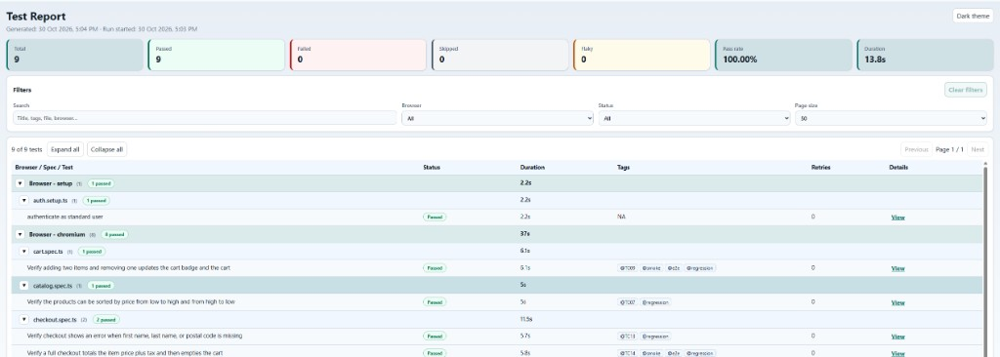

# SauceDemo Playwright + TypeScript Automation

Section A automation suite for [SauceDemo](https://www.saucedemo.com): Playwright, TypeScript, and the Page Object Model.

Repository: https://github.com/Arunachalam-automation/harvee-saucedemo-playwright

## Prerequisites

- Node.js 20+
- npm 10+

## Setup

```bash
npm install
npx playwright install
cp .env.template .env
```

`.env` is gitignored. Public SauceDemo demo accounts are documented in `.env.template` as safe defaults (`BASE_URL`, `STANDARD_USER`, `LOCKED_USER`, `USER_PASSWORD`).

## How to run the tests

Normal `npm test*` commands run Playwright and then generate the **custom HTML report** (including when tests fail). The original Playwright exit code is preserved for CI.

### Full suite

```bash
npm test                          # all browser projects
npm run test:chromium             # Chromium only (recommended for local review)
npm run test:firefox
npm run test:webkit
npm run test:edge
npm run test:chrome
```

### Section A confirmed cases (TC01, TC02, TC03, TC07, TC09, TC13, TC14, TC19)

Bash, macOS, and Linux:

```bash
npm run test:chromium -- --grep "@TC01|@TC02|@TC03|@TC07|@TC09|@TC13|@TC14|@TC19"
```

PowerShell. `--%` stops PowerShell parsing, and `^|` keeps the `|` inside the pattern:

```powershell
npx playwright test --grep --% "@TC01^|@TC02^|@TC03^|@TC07^|@TC09^|@TC13^|@TC14^|@TC19"
```

| ID   | Area     | Spec file                        |
| ---- | -------- | -------------------------------- |
| TC01 | Login    | `tests/login.spec.ts`            |
| TC02 | Login    | `tests/login.spec.ts`            |
| TC03 | Login    | `tests/login.spec.ts`            |
| TC07 | Catalog  | `tests/catalog.spec.ts`          |
| TC09 | Cart     | `tests/cart.spec.ts`             |
| TC13 | Checkout | `tests/checkout.spec.ts`         |
| TC14 | Checkout | `tests/checkout.spec.ts`         |
| TC19 | Session  | `tests/session-security.spec.ts` |

### By tag or file

```bash
npm run test:smoke                # --grep @smoke
npm run test:sanity
npm run test:regression
npm run test:e2e
npm run test:session-security     # session-security.spec.ts on Chromium
npm run test:chromium -- tests/login.spec.ts
npm run test:chromium -- --grep "@TC14"
```

### Discovery helpers

```bash
npm run test:list
npm run test:list:chromium
npm run test:list:obscura
npm run test:list:session-security
```

## View the report

After a run, open the custom HTML report:

```bash
npm run report
```

Example Chromium run (9 passed, 100% pass rate):



Artifacts:

- JSON results → `build/json-report/results.json`
- Custom HTML → `build/html-report/index.html`
- Failure screenshots / traces → under `build/` (Playwright output)

Regenerate HTML from existing JSON without opening a server:

```bash
npm run report
```

## Obscura (optional CDP headless)

[Obscura](https://docs.obscura.sh) is an optional headless browser. Playwright connects to it with `connectOverCDP` instead of launching Chromium. `npm test` and `npm run test:chromium` do not use it. `npm install` does not install it.

`npm run test:obscura` does the whole run in one command:

1. On the first run, download the official build for this machine into the home directory (`~/.obscura`, which is `%USERPROFILE%\.obscura` on Windows). Later runs reuse that binary.
2. Start `obscura serve` on the port in `OBSCURA_CDP_URL` (default `ws://127.0.0.1:9222`).
3. Run the Obscura Playwright project.
4. Stop the server this command started. A server that was already listening is left running.

| Machine             | Archive                        |
| ------------------- | ------------------------------ |
| Windows 64-bit      | `obscura-x86_64-windows.zip`   |
| macOS Apple Silicon | `obscura-aarch64-macos.tar.gz` |
| macOS Intel         | `obscura-x86_64-macos.tar.gz`  |
| Linux 64-bit        | `obscura-x86_64-linux.tar.gz`  |
| Linux ARM64         | `obscura-aarch64-linux.tar.gz` |

Leave `OBSCURA_CDP_TOKEN` blank for a local server. Set it (Bearer, at least 32 bytes) only when Obscura is bound to a non-loopback host.

Authenticated specs on Chromium, Firefox, and WebKit load `.auth/user.json` with Playwright `storageState`. Obscura does not implement `Network.setBypassServiceWorker`, so those specs restore the same file in the page (session cookie and `localStorage`). Login and session-security specs use `testNoAuth` and stay signed out.

```bash
npm run test:obscura
npm run test:obscura:smoke
npm run test:obscura:sanity
npm run test:obscura:regression
npm run test:obscura:e2e
npm run test:obscura:login
npm run test:obscura:session-security
npm run test:obscura -- tests/cart.spec.ts --grep "@TC09"
```

## Projects

| Project                                               | Role                                                                 |
| ----------------------------------------------------- | -------------------------------------------------------------------- |
| `setup`                                               | Writes `.auth/user.json` via `tests/auth.setup.ts`                   |
| `chromium` / `firefox` / `webkit` / `edge` / `chrome` | Full suite; login/session-security use `testNoAuth` (empty storage)  |
| `obscura`                                             | Opt-in CDP browser. `npm run test:obscura*` starts it, then stops it |

Unauthenticated specs import `testNoAuth` from `fixtures/test-fixtures.ts` so they clear project `storageState` without a separate Playwright project.

## Quality scripts

Static checks that do not open a browser. Run them before committing or in CI alongside the suite.

```bash
npm run typecheck      # TypeScript (`tsc --noEmit`) — catches type errors across specs, pages, and config
npm run format:check   # Prettier check — fails if files are not formatted
npm run format         # Prettier write — formats the repo in place
```

## Repository layout

- `tests/` – specs and auth setup
- `pages/` – page objects
- `fixtures/` – shared fixtures
- `test-data/` – JSON test data by feature
- `reporters/` – console + custom HTML reporters
- `scripts/report/` – custom HTML report generator
- `scripts/run-with-report.mjs` – test + report orchestration
- `scripts/start-obscura.mjs` – downloads Obscura for this OS, starts it, runs the test command, then stops it
